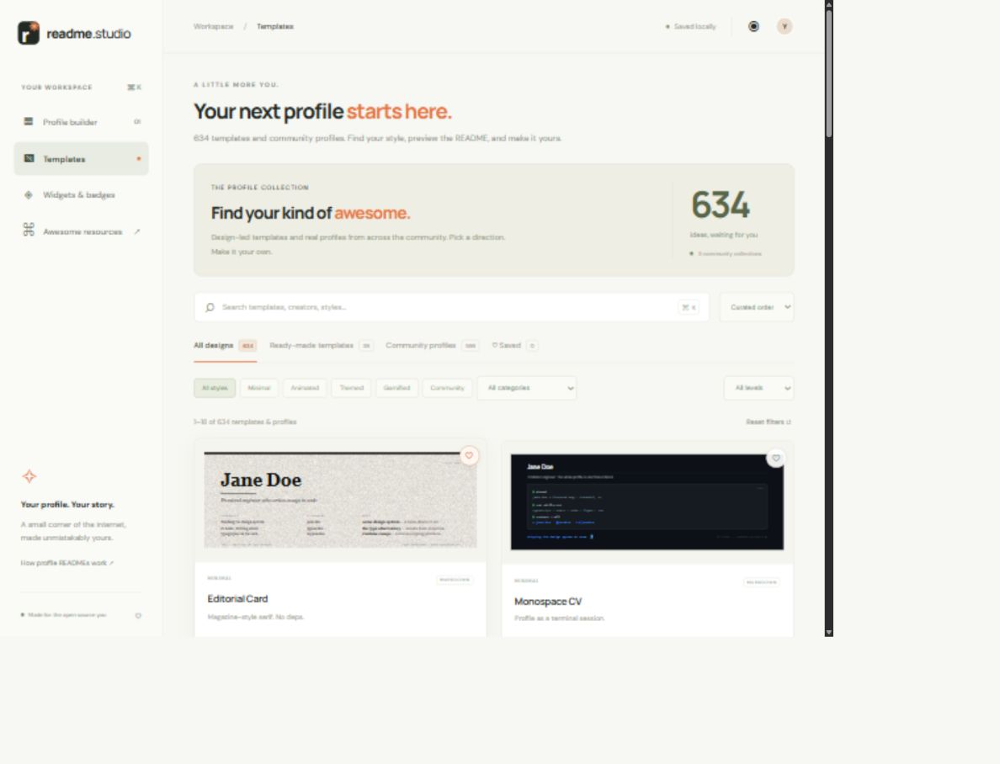

# README Studio

[Open the live website](https://cit-24-01-0476-maker.github.io/readme-studio/) · [Browse templates](https://cit-24-01-0476-maker.github.io/readme-studio/#templates)

A responsive, local-first GitHub profile README builder. No installation or API keys required.

## Run

With Node.js installed, run `npm start` from this directory, then open http://localhost:4173.

The `dist` directory is a standalone static website and can also be deployed to any static host.

## Features

- Import a public GitHub profile, up to 100 recently updated public repositories, and the profile repository README.
- Edit your name, headline, bio, current work, learning, location, and links.
- Browse 634 gallery entries: 32 design-led templates, 596 unique community profile examples, and six guided Studio starters.
- Search by creator, name, tags, or style; filter by category/type/difficulty; sort, paginate, and save favorites locally.
- Preview original README content, customize template placeholders using imported profile details, and open any available source in a live Markdown editor.
- Export a README or a design ZIP with its SVG, original setup guide, and MIT license.
- Choose from 32 technology badges.
- Optional statistics, language, streak, and repository sections.
- Safe live Markdown preview, source view, copy, and README.md download.
- Twelve curated community resources with search.
- Automatic browser-local saving and responsive layout.

Import uses the unauthenticated GitHub REST API and is subject to its rate limits. Private repositories are not imported. Featured repositories are ranked by stars among the first 100 recently updated repositories. Imported Markdown can be added to the additional Markdown field. The preview supports GitHub-flavored Markdown and sanitized HTML, including tables and collapsible sections. Preview rendering approximates GitHub's CSS.

Community examples preserve the original author's content and links. Edit these before publishing and check the linked source for reuse terms. They are clearly distinguished from ready-made templates. Remote previews can fail if the source moves or its images are unavailable.

SVG templates ship their original example text in the SVG source. Edit its text labels before uploading; README placeholders can be edited in the app. Action templates need the setup in the bundled `SETUP.md`; exporting a README alone will not generate their dynamic images. Gallery images show the upstream examples, rather than live personal contribution data.

Badges, statistics cards, and fonts load from third-party providers. Their availability and exact appearance depend on those services. Statistics need a GitHub username. There is no GitHub OAuth connection or direct repository publishing; the export dialog explains how to upload your README.

Data is saved only in this browser's local storage. Use Start fresh to clear the current profile. Importing replaces the profile fields and featured repositories; additional Markdown stays until edited or cleared.

## Check

Run `npm run check` for JavaScript syntax validation.

This also validates catalog counts, deduplication, source links, and every bundled SVG, guide, and license. Run `npm run catalog:update` to rebuild the catalog from its three original sources. This requires internet access. Source definitions and the update script are in `scripts/build-catalog.mjs`; credits are in `THIRD_PARTY.md`.

## Hosting

The live website is deployed to GitHub Pages from `dist/`. The workflow in `.github/workflows/deploy-pages.yml` validates the source and catalog, then deploys on every push to `main`.

To deploy a fork, enable GitHub Pages and select **GitHub Actions** as the source. For Vercel, import the repository; `vercel.json` already selects the `dist` output directory and validation command.

## Preview

